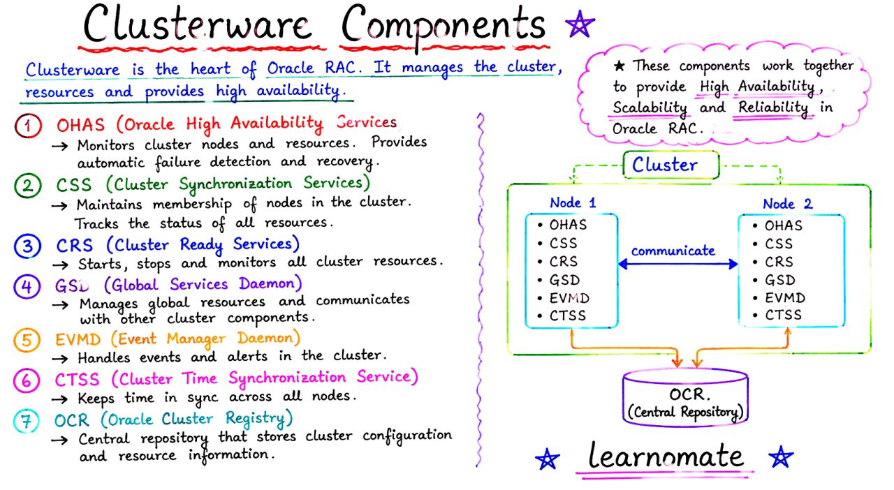

# Oracle Learning Guide: Memory, Backup, RAC & Data Guard

This guide provides simplified explanations for **beginners** and **advanced topics** for experienced DBAs.

---

## 📚 Overview of Documents & Diagrams

You have 5 key learning materials covering essential Oracle Database concepts:

1. **oracle_memory.md** - Core memory concepts
2. **Image 1: Oracle Memory Parameters Complete Guide** - Memory architecture deep dive
3. **Image 2: Oracle Database Backup Complete Notes** - Backup strategies & RMAN
4. **Image 3: SCAN Listener in Oracle RAC** - Cluster connection management
5. **Image 4: Redo Transport Services Explained** - Data Guard protection mechanisms

---

## 🟢 FOR BEGINNERS

### 1. Oracle Memory Basics
**What is Memory in Oracle?**
- Oracle database uses **two main memory areas**:
  - **SGA (System Global Area)**: Shared memory used by all users
  - **PGA (Program Global Area)**: Private memory for each user session

**Key Parameters to Know:**
- `MEMORY_TARGET`: Total memory allocated (easiest way - Oracle manages everything)
- `SGA_TARGET`: Let Oracle auto-manage SGA components only
- `DB_CACHE_SIZE`: How much memory for storing data blocks

**Real-world analogy**: Think of SGA as a company's break room (shared by everyone) and PGA as each employee's desk space (private).

---

### 2. Oracle Backup Basics
**Why Backup Matters**
- **Protects your data** from hardware failures, user mistakes, and disasters
- **Required for business continuity** - no backup = no recovery

**Backup Types (Simplest to Most Common)**
| Type | What It Backs Up | When Used |
|------|-----------------|-----------|
| **Full Backup** | Everything | Weekly |
| **Incremental Backup** | Only changed data since last backup | Daily (faster) |
| **Archive Log Backup** | Transaction logs | Hourly |

**Backup Destinations:**
- Disk (fast, local)
- Tape (slow, long-term storage)
- ASM (Oracle's storage system)
- Network location (remote backup)

**Recovery Flow (Simple Version):**
```
Database Failure → Restore Backups → Apply Redo Logs → Open Database
```

---

### 3. Oracle RAC Basics
**What is RAC?**
- **RAC = Real Application Cluster**: Multiple servers running same database
- **Benefits**: High availability (if one server down, others work), load balancing

**SCAN Listener - The Traffic Director:**
- Think of it as a **smart receptionist** at the cluster entrance
- Clients connect to **one address** (SCAN name), not individual servers
- SCAN automatically directs to the best available node

**Connection Flow:**
```
Client → DNS → SCAN Listener → Finds Best Node → Local Listener → Database Instance
```

**Key Benefits:**
- Single entry point (no need to know individual server names)
- Automatic load balancing
- High availability (if one node fails, others continue)

---

### 4. Data Guard Basics
**What is Data Guard?**
- **Automatic replication** of database to a standby location
- If primary fails, **instantly switch to standby**
- Acts as disaster recovery + backup

**Three Transport Modes (Simplest to Safest):**

| Mode | Speed | Data Safety | Use Case |
|------|-------|-------------|----------|
| **ASYNC** | Fast ⚡ | May lose some data | High-performance systems |
| **FASTSYNC** | Medium ⚙️ | Balanced | Most production systems |
| **SYNC** | Slow 🐢 | No data loss | Critical systems |

**How It Works (Simple):**
```
Transactions → Redo Logs Generated → Sent to Standby → Applied on Standby
```

---

## 🔵 FOR ADVANCED LEARNERS

### 1. Advanced Memory Management

**Automatic Memory Management (AMM) vs Manual**
- **AMM (MEMORY_TARGET)**: Modern approach, Oracle handles SGA+PGA dynamically
- **ASMM (SGA_TARGET)**: Only for SGA, manual PGA control needed
- **Manual**: Fine-grained control, requires deep expertise

**Memory Components Detail:**

| Component | Purpose | Tuning Impact |
|-----------|---------|--------------|
| **Shared Pool** | SQL parsing, PL/SQL compilation | High - affects soft parse ratio |
| **Buffer Cache** | Data block caching | Critical - higher = fewer disk I/O |
| **Large Pool** | Parallel queries, RMAN, Session memory | Important for parallel operations |
| **Java Pool** | Java execution in DB | Only if using Java stored procedures |
| **Streams Pool** | GoldenGate, XStream, etc. | Only if using replication |

**Key Metrics for Performance Tuning:**
```sql
-- Check memory usage
SELECT * FROM V$SGASTAT;           -- SGA breakdown
SELECT * FROM V$MEMORY_DYNAMIC_COMPONENTS;  -- Dynamic changes
SELECT * FROM V$MEMORY_TARGET_ADVICE;  -- Memory recommendations
```

---

### 2. Advanced Backup Strategies

**RMAN (Recovery Manager) Architecture:**
- **RMAN** = Oracle's recommended backup tool (not OS commands)
- Manages incremental, differential, and archived logs
- Tracks backup metadata in recovery catalog or control file

**Advanced Concepts:**

**a) Backup Optimization**
```sql
-- Full backup
BACKUP DATABASE;

-- Incremental level 0 (baseline)
BACKUP INCREMENTAL LEVEL 0 DATABASE;

-- Incremental level 1 (since last level 0)
BACKUP INCREMENTAL LEVEL 1 DATABASE;

-- Differential backup (since last backup at any level)
BACKUP INCREMENTAL LEVEL 1 CUMULATIVE DATABASE;
```

**b) Archivelog Modes**
- **NOARCHIVELOG**: No recovery possible, faster, development only
- **ARCHIVELOG**: Every log is archived, recoverable, production standard

**c) Backup Destinations & FRA (Fast Recovery Area)**
```sql
-- Configure FRA
CONFIGURE DB_RECOVERY_FILE_DEST = '/backup_location';
CONFIGURE DB_RECOVERY_FILE_DEST_SIZE = 500G;
CONFIGURE RETENTION POLICY TO RECOVERY WINDOW OF 7 DAYS;
```

**d) Parallelization (Important!)**
```bash
# WRONG ❌ - Single file, poor parallelization
expdp system/password dumpfile=export.dmp parallel=4

# CORRECT ✓ - Multiple files, true parallel I/O
expdp system/password dumpfile=export_%U.dmp parallel=4
# Creates: export_01.dmp, export_02.dmp, export_03.dmp, export_04.dmp
```

**Common RMAN Commands:**
```sql
BACKUP DATABASE PLUS ARCHIVELOG;              -- Full backup with logs
BACKUP INCREMENTAL LEVEL 0 ARCHIVELOG ALL;   -- Baseline + archives
LIST BACKUP SUMMARY;                          -- View backup history
RESTORE DATABASE;                             -- Restore from backup
RECOVER DATABASE;                             -- Apply redo logs
```

---

### 3. RAC Deep Dive

**SCAN (Single Client Access Name) - Advanced**

**Behind the Scenes:**
- SCAN is a **DNS alias** pointing to multiple IPs (one per RAC node)
- DNS round-robin automatically returns different IPs on each query
- Client connects to one SCAN IP, SCAN Listener redirects to best node

**SCAN Listener Intelligence:**
- Uses **load metrics** (CPU, memory, sessions) to route connections
- No static assignment - dynamic based on real-time cluster health
- Important: SCAN Listener does **NOT** manage sessions, only redirects

**Connection String Evolution:**
```
Old way:  connect/@racdb1     or connect/@racdb2 (must know each node)
New way:  connect/@racscan    (single entry point, auto-load balanced)
```

**Cluster Interconnect:**
- Nodes communicate via **private interconnect** (Gigabit Ethernet)
- Separate from public network
- Critical for cluster health - if interconnect fails, split-brain can occur

**Cache Fusion (Advanced Caching in RAC):**
- Blocks are **shared between instances** in memory
- Very fast block-level synchronization across cluster
- Reduces disk I/O significantly

---

### 4. Data Guard - Production Architecture

**Three Transport Modes - Technical Comparison:**

**SYNC Mode (Synchronous)**
```
Primary: Write redo → Wait for ACK from standby → Commit
Risk: Zero data loss, but slower (waits for network round-trip)
Best for: Mission-critical systems (finance, healthcare)
```

**ASYNC Mode (Asynchronous)**
```
Primary: Write redo → Commit immediately → Send to standby
Risk: May lose data if primary fails before redo sent
Best for: High-performance systems, acceptable data loss
```

**FASTSYNC Mode (Hybrid)**
```
Primary: Writes to SRL (Standby Redo Log) → Commit
Risk: Between SYNC and ASYNC, writes to disk not network
Best for: Most production systems (balanced protection + performance)
```

**Redo Transport Internals:**
```
Step 1: Transaction commits on PRIMARY
Step 2: LGWR (Log Writer) writes redo to online redo logs
Step 3: LNS (Log Network Server) ships redo blocks to standby
Step 4: RFS (Remote File Server) on standby receives & writes to SRL
Step 5: MRP (Media Recovery Process) applies to standby database
Step 6: Standby DB is always recovered state (can instantly open as primary)
```

**High-Availability Features:**
- **Broker**: Automated failover without manual intervention
- **Fast-Start Failover**: Complete in seconds
- **Role Transitions**: Primary ↔ Standby role switching

**Monitoring Data Guard Health:**
```sql
-- Check Data Guard status
SELECT PROTECTION_MODE, OPEN_CURSORS FROM V$DATABASE;

-- Check standby status
SELECT PROCESS, STATUS FROM V$MANAGED_STANDBY;

-- Monitor redo shipping
SELECT * FROM V$ARCHIVE_DEST_STATUS;
```

---

### 5. Advanced Performance Considerations

**Memory vs I/O Trade-offs:**
- **Increase buffer cache** → More data in memory → Fewer disk reads
- **Limit point**: Physical RAM available
- **Diminishing returns**: After 80% hit ratio, benefit decreases

**RAC-Specific Tuning:**
- **Minimize interconnect traffic**: Partition data by instance when possible
- **Monitor GC (Global Cache)** for contention between instances
- **Use affinity**: Route sessions to instances holding their data

**Data Guard Performance Impact:**
- **SYNC mode**: 10-30% slower writes (waits for network ACK)
- **FASTSYNC**: 2-5% slower (writes to disk first)
- **ASYNC**: Negligible performance impact

---

## 📊 Quick Reference Comparison Tables

### Memory Parameters
| Feature | MEMORY_TARGET | SGA_TARGET | Manual |
|---------|--------------|-----------|--------|
| **Ease of Use** | Very Easy | Easy | Hard |
| **Flexibility** | Limited | Medium | Full |
| **Auto-Tuning** | Yes (SGA+PGA) | Yes (SGA only) | No |
| **Production Use** | Recommended | Less common | Legacy |

### Backup Strategies
| Type | Speed | Disk Usage | Recovery Time |
|------|-------|-----------|---------------|
| **Full** | Slow | 100% | Fast |
| **Incremental** | Fast | 20-30% | Medium |
| **Differential** | Medium | 10-20% | Medium |
| **Archive Only** | Varies | Small | Slowest |

### RAC Components
| Component | Purpose | Failover Impact |
|-----------|---------|-----------------|
| **SCAN** | Connection routing | No (automatic) |
| **Interconnect** | Node communication | Split-brain risk |
| **Shared Storage** | Data accessibility | Critical |
| **Cluster** | Coordination | Automatic failover |

### Data Guard Modes
| Mode | Commit Wait | Data Loss Risk | Use Case |
|------|-----------|---------------|----------|
| **SYNC** | Wait for RFS ACK | None | Critical |
| **ASYNC** | No wait | Possible | High performance |
| **FASTSYNC** | Wait for SRL write | Minimal | Balanced |

---

## 🎯 Interview Questions & Answers

**Q1: What's the difference between AMM and ASMM?**
- **AMM (MEMORY_TARGET)**: Manages both SGA and PGA dynamically
- **ASMM (SGA_TARGET)**: Only manages SGA components, PGA is separate
- **Answer**: Use AMM in production for easier management

**Q2: Why is DUMPFILE=filename_%U.dmp important for parallelization?**
- **%U** auto-generates multiple files matching PARALLEL value
- Each parallel worker gets its own file → No I/O contention
- Without it: All workers write to same file → Serialization → No speedup

**Q3: What happens if SCAN Listener fails?**
- SCAN Listener is **not** part of database, only redirects connections
- If it fails: New connections fail, but existing sessions continue
- Solution: Fix listener or use node connection strings

**Q4: Which Data Guard mode has zero data loss?**
- **SYNC mode**: Waits for standby acknowledgment before commit
- Slowest but safest

**Q5: What's the relationship between Redo Transport and RMAN backup?**
- **Redo Transport**: Sends redo logs to standby in real-time
- **RMAN Backup**: Creates point-in-time backup snapshots
- Both are needed: Backup for recovery, redo for standby

---

## 📚 Study Path

### Week 1-2: Beginner
1. Understand SGA vs PGA
2. Learn basic backup types
3. Know what SCAN is
4. Understand Data Guard concept

### Week 3-4: Intermediate
1. Study memory tuning parameters
2. Learn RMAN commands
3. Understand RAC cluster concepts
4. Study Data Guard modes

### Week 5+: Advanced
1. Memory optimization techniques
2. Backup parallelization strategies
3. RAC troubleshooting
4. Data Guard failover scenarios

---

## 💡 Key Takeaways

1. **Memory**: Use MEMORY_TARGET for modern systems (AMM)
2. **Backup**: Always use RMAN in production, test recovery regularly
3. **RAC**: SCAN simplifies connection management automatically
4. **Data Guard**: Choose mode based on RPO/RTO requirements (SYNC=safe, ASYNC=fast)
5. **Performance**: Monitor actual usage (V$ views), tune based on data

# Oracle RAC 
Oracle RAC becomes much easier when you understand the Clusterware components behind it.

From CSS to CRS, EVMD to OCR — every component plays a critical role in keeping the cluster highly available and synchronized. 
Understanding Clusterware is the foundation of mastering Oracle RAC.
Which Clusterware component do you find most confusing while learning RAC? 
<br> <br>

