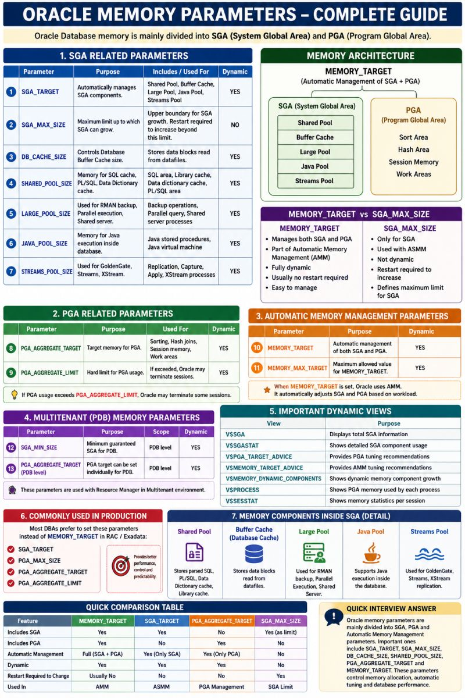

Oracle memory is mainly divided into SGA (System Global Area) and PGA (Program Global Area). Below are the important Oracle memory parameters every DBA should know:

1. Automatic Memory Management
(AMM)MEMORY_TARGET
Total memory allocated for both SGA and PGA.
Oracle automatically manages SGA and PGA within this limit.

2.Automatic Shared Memory Management (ASMM) SGA_TARGET
Oracle automatically manages SGA components. 
   

