# Course resources Information 
While the current class material refers to IBM Power9 and Red Hat Enterprise Linux 7, most of its content remains valid and applicable to IBM Power10 and Red Hat Enterprise Linux 9.2. 
Notes are included below the videos when essential remarks need to be highlighted due to product or service updates.
Refer to the following website for more information: 
https://www.ibm.com/servers
As of 12/14/2024 - the lab exercises have been updated to use Red Hat Enterprise Linux 9.2. 
# understanding power system naming convention
AXYZ
A letter that represents the type of server.  
​LC ---> means Linux only server. 
​H  ---> means SAP HANA optimized server.  
​AC ---> stands for accelerated computing server which focuses on AI workloads   
​S  ---> stands for scale out server. 
E  ---> enterprise scale up server. 

X Letter represent  
7 ---> Power7  
8 ---> Power8  
9 ---> power9  
10 --> Power10  
Y represent the number of sockets.
Z represent the height of server
# virtualization in Your server
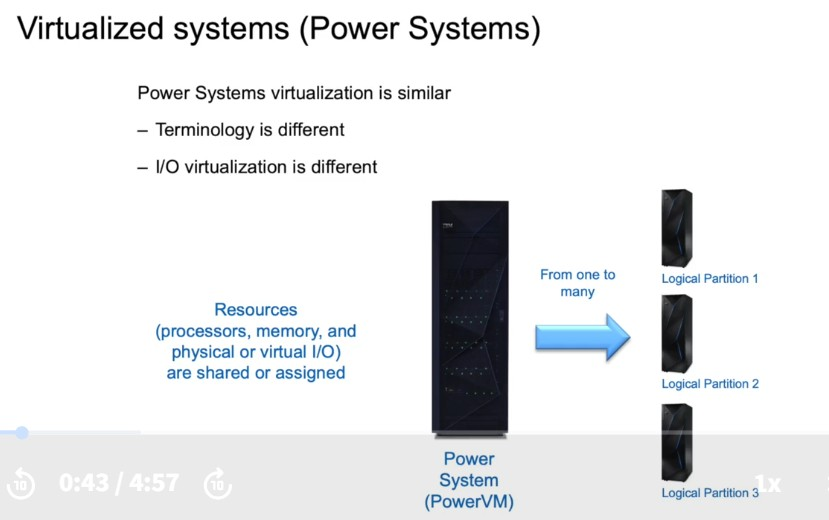    
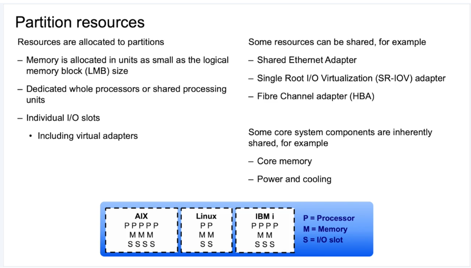

# Managing Virtualization
Power virtualization stack (cloud virtualization) : 
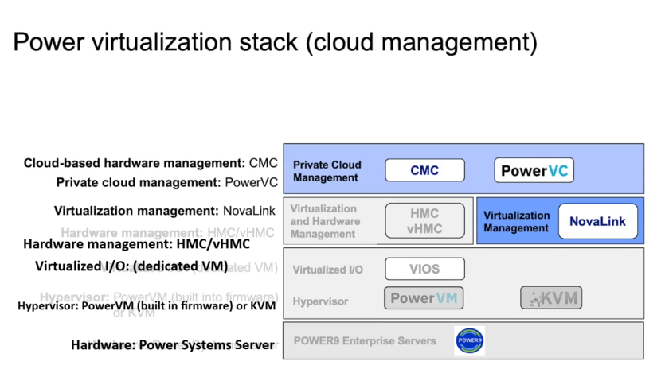
This diagram explains the IBM Power Virtualization Stack for cloud management in IBM Power Systems (POWER9 servers).

It shows the layered architecture from physical hardware to cloud management:

1. Hardware Layer – Physical IBM Power servers (POWER9).  
2. Hypervisor Layer – Uses PowerVM (IBM’s virtualization technology) or KVM to run virtual machines.  
3. Virtualized I/O Layer – VIOS (Virtual I/O Server) provides shared storage and networking resources to VMs. 
4. Management Layer – HMC/vHMC and NovaLink manage virtualization and hardware resources.  
5. Cloud Management Layer – CMC and PowerVC provide centralized cloud/private cloud management and automation.  

In short, the image shows how IBM Power infrastructure is virtualized and managed from hardware up to cloud orchestration.

# IBM POWER10
The IBM Power10 server virtualization stack is similar to POWER9, but with newer management, automation, security, and hybrid cloud capabilities. 
Here is the typical Power10 Virtualization Stack (Cloud Management):

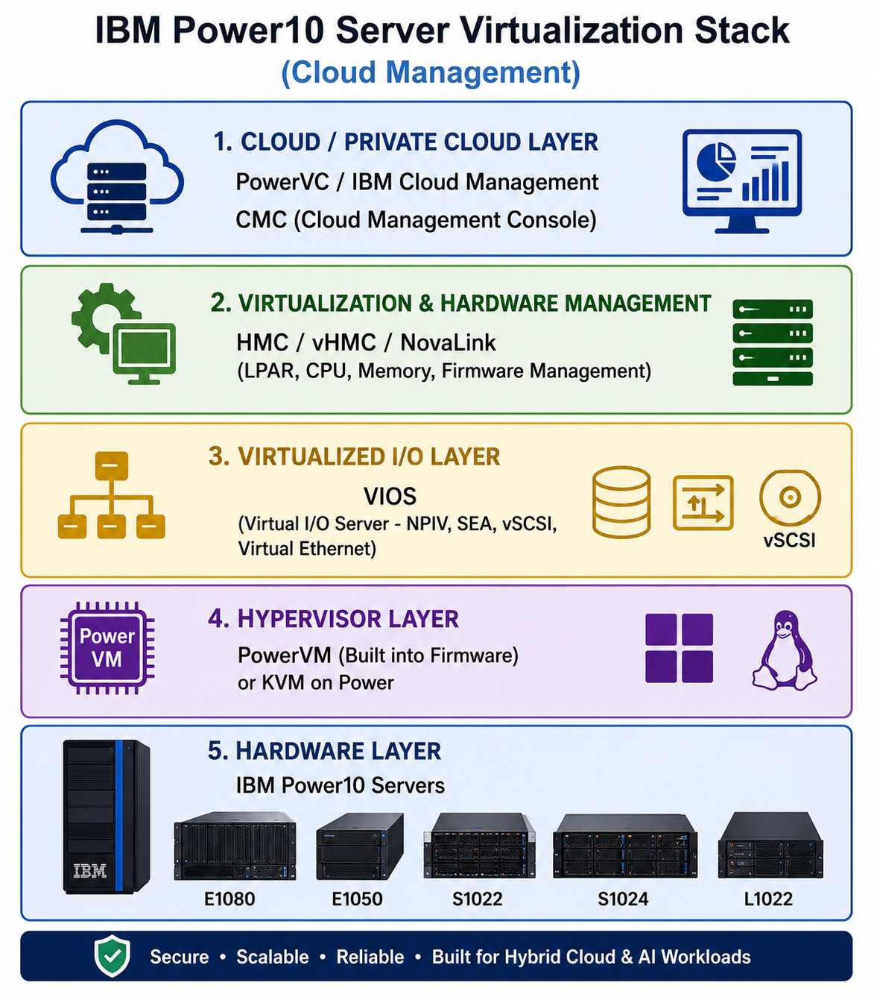

description each components of POWER10

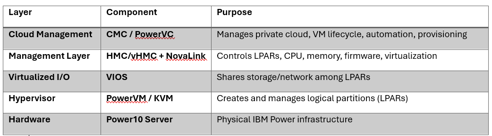

# Key Differences: POWER9 vs POWER10

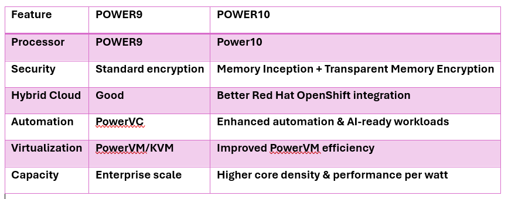

Power10 Virtualization Flow

Physical Server → Hypervisor (PowerVM) → VIOS → LPARs (AIX/Linux/IBM i) → HMC/NovaLink → PowerVC/Cloud Management
  For example, in a Power10 E1080:

* Hardware = Power10 server 
* Hypervisor = PowerVM 
* I/O virtualization = VIOS
* LPAR management = HMC or NovaLink
* Cloud provisioning = PowerVC

This is the architecture commonly used for AIX 7.2/7.3, RHEL, Oracle DB, SAP, and enterprise banking workloads on IBM Power10.
# Power Virtualization stack (multicloud management)

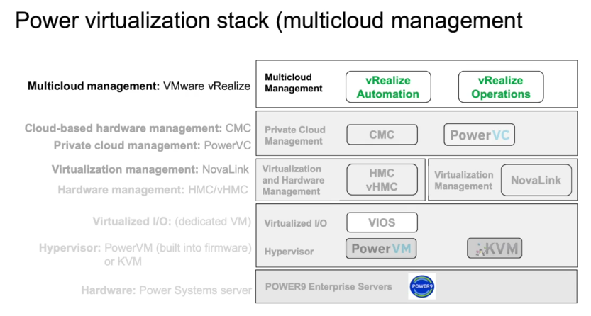

# Processor Concept
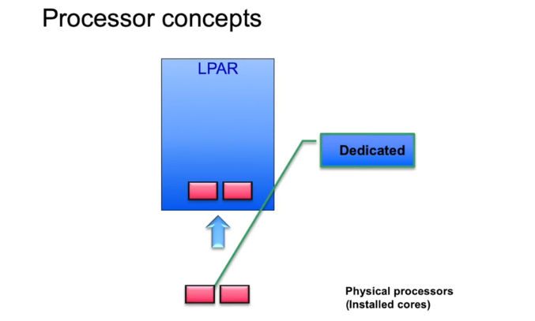    
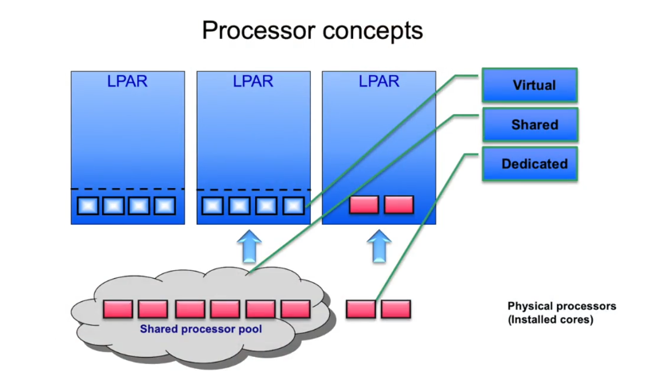   
Additional Processor (Logical Processor)
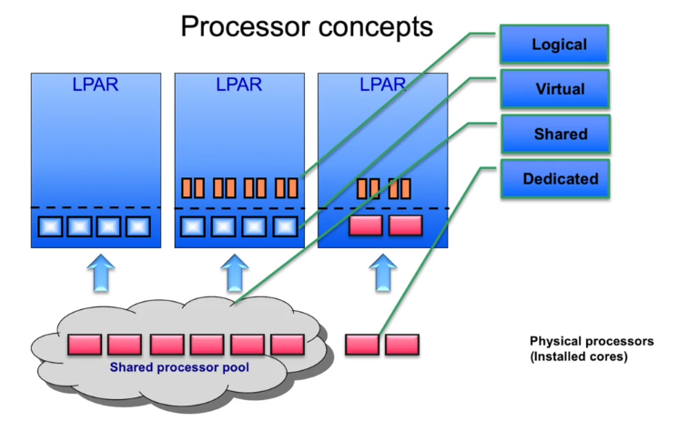    
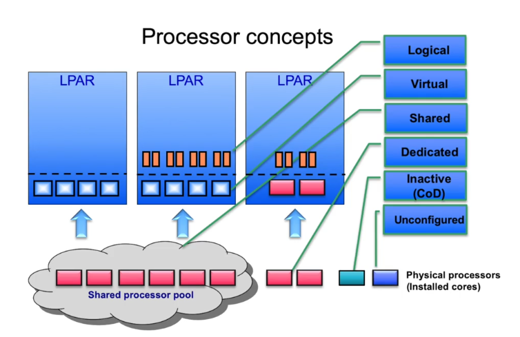    
PowerVM summary     
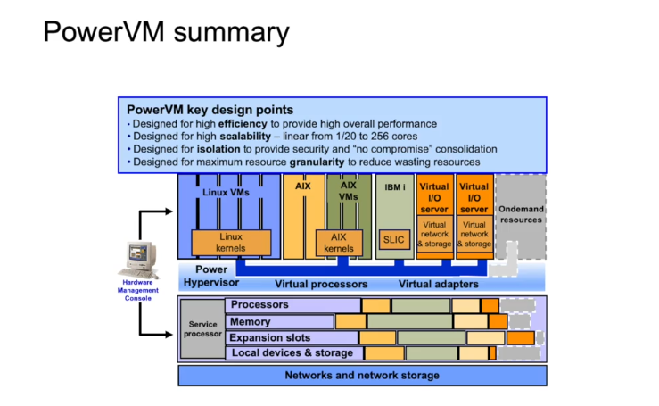

# Graded Assignment: Questions for peer review

Write about why virtualization helps improve efficiency on a server. 

Another student from this course will review your answer. Ensure you cover these;

1. IBM Power server hardware features.

2. How virtualization can be achieved in general. 

3. How IBM Power does virtualization and how it adds to efficient usage of resources. 

4. What business case can you think of, to deploy your own computing environmnet with virtualization?
- answser all previous question   
# Documents
- [Linux Admin Manual](Why Virtualization Helps Improve Efficiency on a Server.pdf)