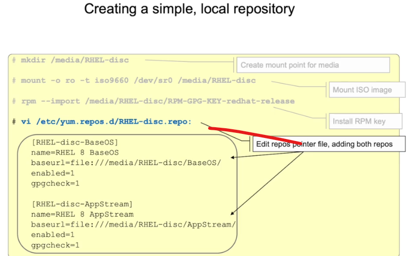
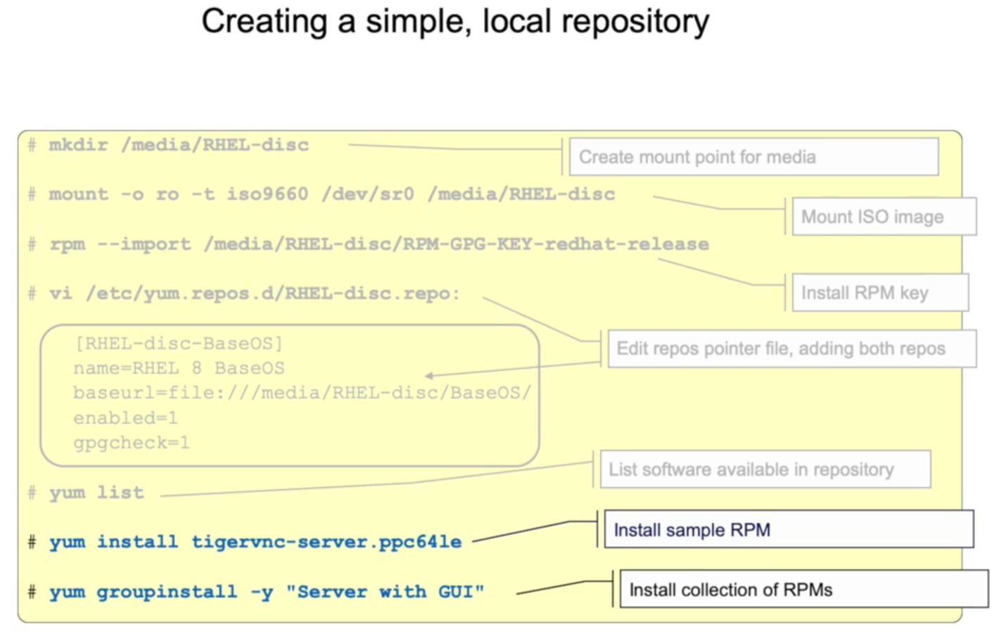
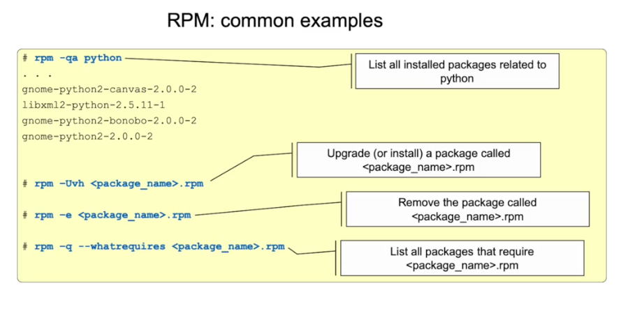

# How to enable sudo user role
---- salim is a normal user. he wants to add new user jack

[salim@rhcsa ~]$ sudo useradd jack
userdel: Permission denied.
userdel: cannot lock /etc/passwd; try again later.
[salim@rhcsa ~]$ su - root 
[root@rhcsa ~]$ visudo 
now add below line 

## Allow root to run any commands anywhere
root    ALL=(ALL)       ALL
    
salim  ALL=(ALL)        /sbin/useradd, /sbin/userdel

save and exit.
Now try to add and remove new users using user: salim

---- package management.
- YUM- Yellowdog Updater Modified
- DNF- Dandified
- RPM- RedHat Package Manager

      
    

[root@rhcsa ~]$ yum list 
[root@rhcsa ~]$ yum info package_name  
[root@rhcsa ~]$ yum grouplist  
[root@rhcsa ~]$ yum erase package_name 
